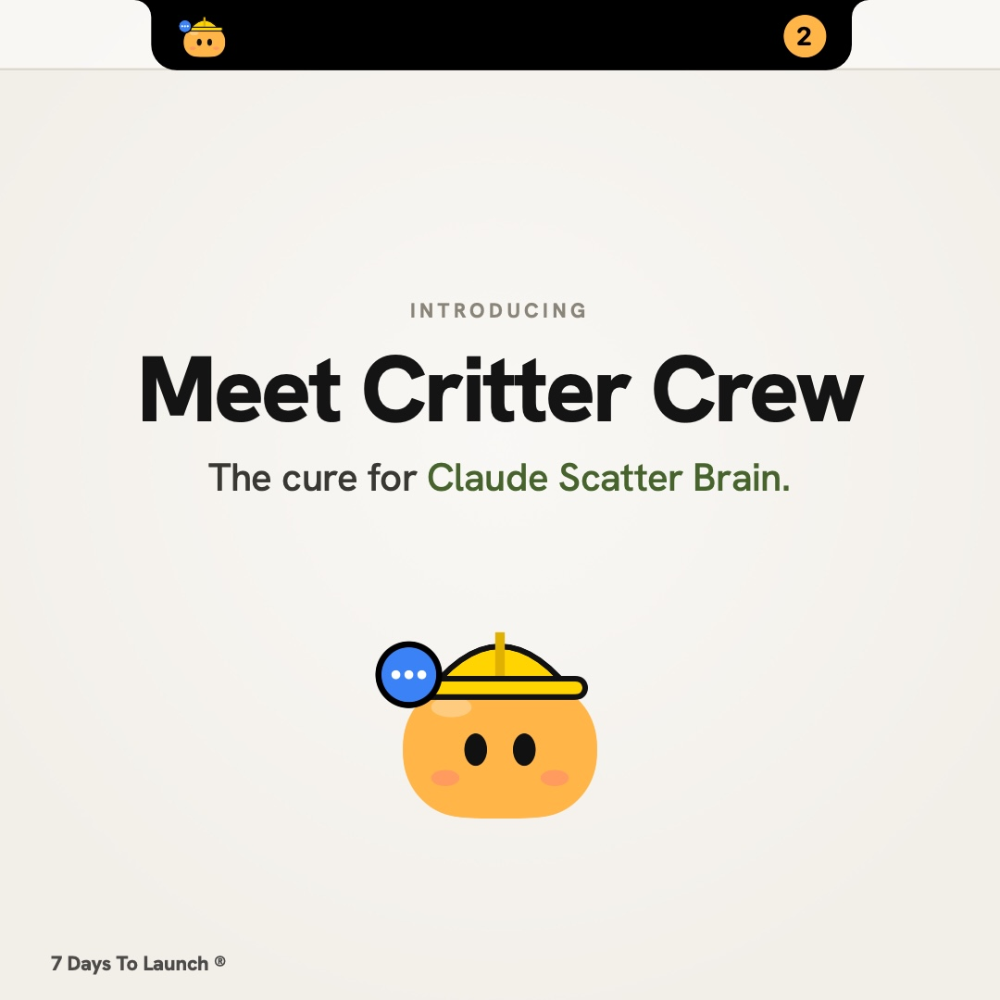

# Critter Crew

**The cure for Claude Scatter Brain.**

Too many Claude tasks running, and some get left behind. Critter Crew puts every Claude Code task into your MacBook's notch as its own little critter, so you can see at a glance which one needs you.

[](docs/critter-crew.mp4)

## What the critters tell you

| Critter | Means |
|---|---|
| Bouncing, eyes darting | **Working.** Hover to see what it's doing right now ("Editing cart.ts", "Running the test suite"). |
| Bouncing with a blue speech bubble | **Your turn.** It finished and you haven't looked yet. It pops out of the notch to tell you. |
| Red ! | **Needs you.** It's waiting on an approval or an answer. |
| Eyes closed, zzz | **Asleep.** Nothing's happened for a few hours. |

Every project gets its own critter (hard hat, shades, antenna, nightcap and more), so you can tell them apart at a glance.

## Using it

- **Hover the notch** to open the crew. Hover a task to see what it's doing, click it to jump straight back into it in Claude.
- **The minus button** tucks it back into the notch.
- **Right-click** the island to mark everything as seen, pick critters, or quit.

## Install

You'll need a Mac on macOS 14 or later (a notch MacBook looks best, but it works on any screen) and Xcode or the Xcode command line tools (`xcode-select --install`).

```bash
git clone https://github.com/dogstairsau/critter-crew.git
cd critter-crew
./build.sh
open "build/Critter Crew.app"
```

To start it automatically, add **Critter Crew** under System Settings → General → Login Items.

## Pick your critters

Each project folder gets a colour and an accessory automatically. To choose your own, right-click the island → **Edit critters…**, or edit `~/Library/Application Support/CritterCrew/crew.json`:

```json
{
  "my-website": { "color": "#FFB547", "accessory": "hardHat" }
}
```

Accessories: `hardHat`, `shades`, `antenna`, `beanie`, `crown`, `headphones`, `bow`, `partyHat`, `chefHat`, `flower`, `glasses`, `sprout`, `nightcap`.

## How it works

Critter Crew only reads files on your Mac, and nothing leaves it:

- `~/.claude/sessions/` for which Claude tasks are running and whether they're busy or waiting.
- The Claude desktop app's task list (`~/Library/Application Support/Claude/claude-code-sessions/`) for titles, last activity and when you last looked.
- Each task's transcript in `~/.claude/projects/` for the live "what it's doing" line.

These are Claude's internal files, not a public API, so a Claude update could change them. The **Open** button uses the Claude app's `claude://` link to jump to a task.

---

Built by [7 Days To Launch](https://www.7daystolaunch.studio/). Briefed Monday. Live by Sunday.

Not affiliated with or endorsed by Anthropic. Claude is a trademark of Anthropic.
